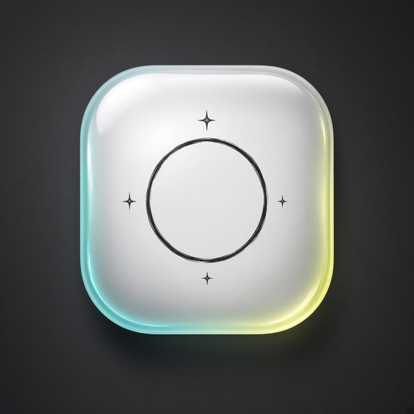
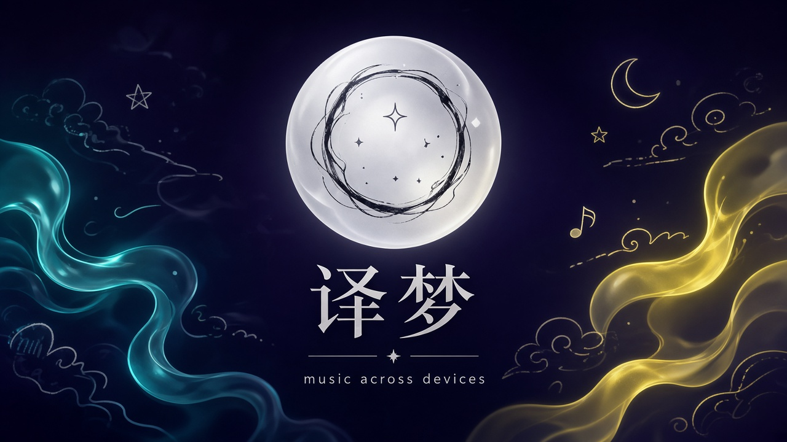
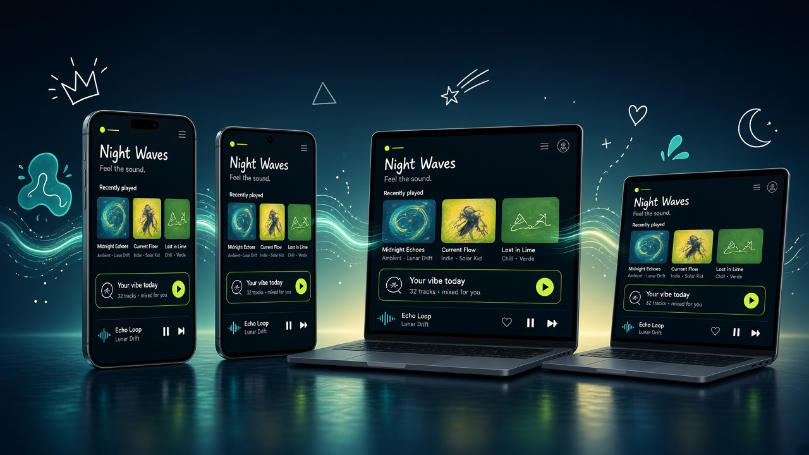
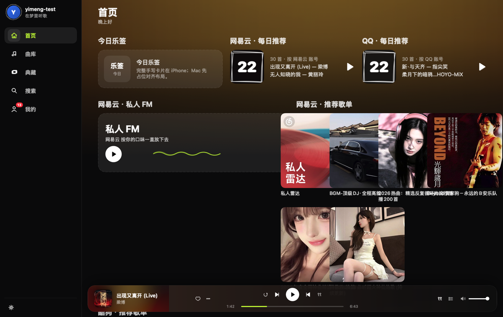
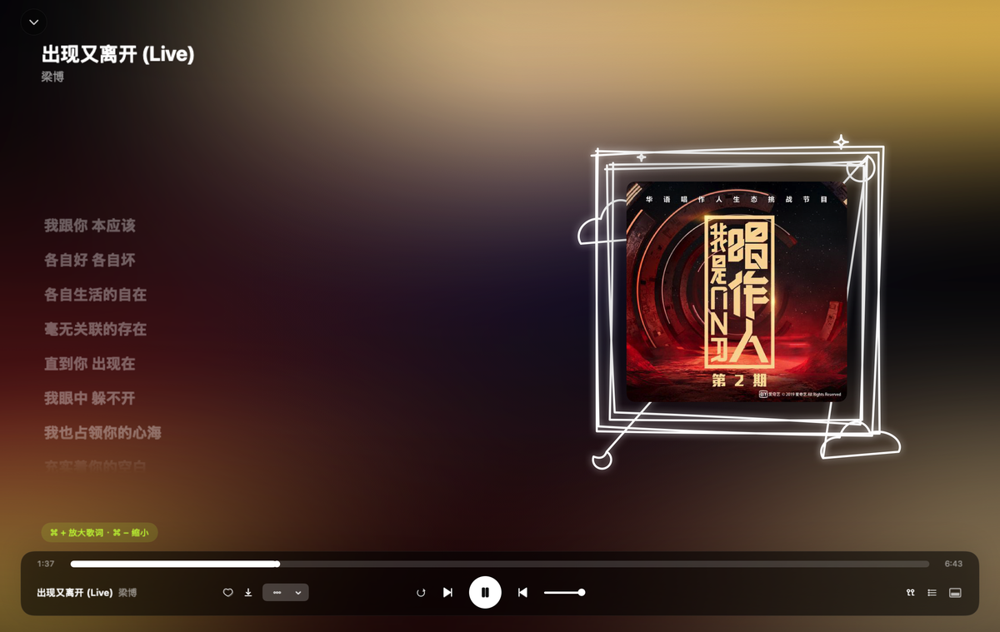
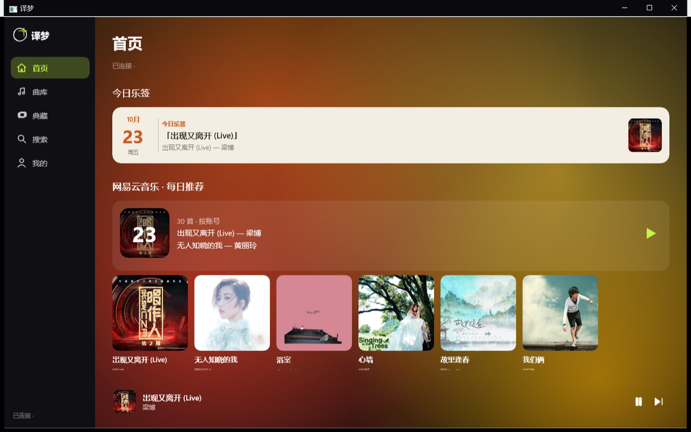
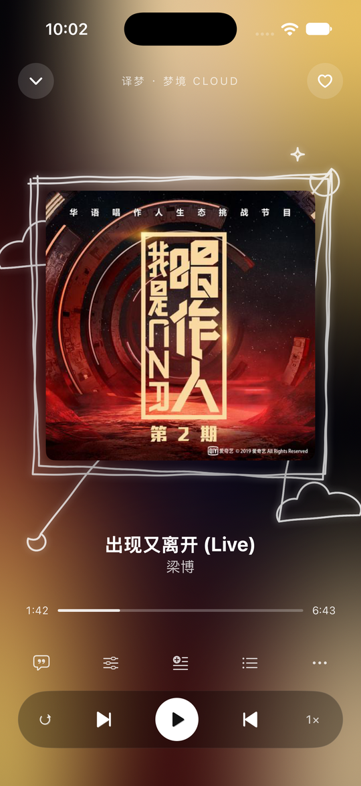
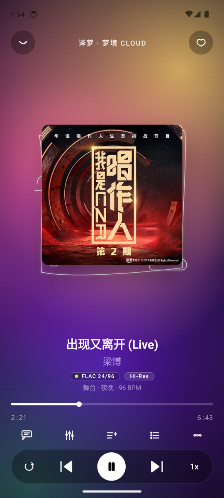
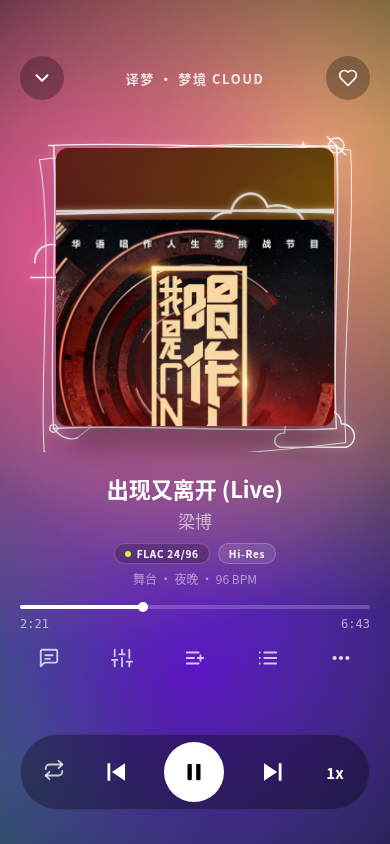
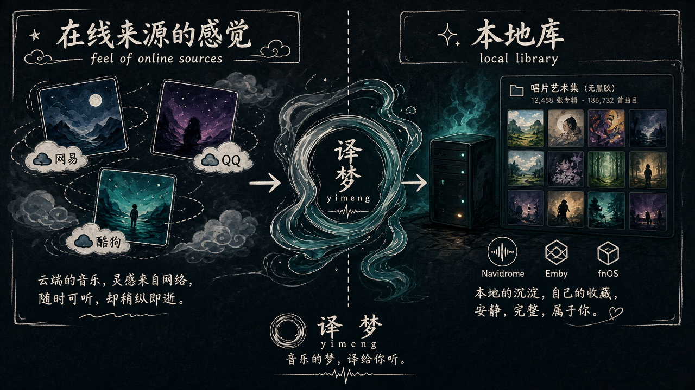

<p align="center">
  
</p>

<h1 align="center">译梦</h1>

<p align="center">
  <strong>跨平台 · 多设备 · 在线音源 · 本地曲库</strong><br/>
  把网易 / QQ / 酷狗的推荐，和 NAS 里的珍藏，放进同一个「梦中的涂鸦」。
</p>

<p align="center">
  
  
  
  
  
  
</p>

<p align="center">
  
</p>

---

## 这是什么

**译梦**是一套自托管的音乐管理 / 播放产品：Core 跑在你的 NAS 或家里服务器上，手机、平板、Mac、Windows 共用同一套视觉语言——深色「梦中的涂鸦」、液态玻璃梦境环、手绘描边图标。

> 个人非商用。平台凭证只进 Core Vault，不绕 DRM。

---

## 跨平台 / 多设备

<p align="center">
  
</p>

| 端 | 技术 | 状态 |
|----|------|------|
| **iOS / iPad** | SwiftUI | 主力体验：手势、长按菜单、乐签、离线缓存、识曲… |
| **macOS** | 同一套 iOS 工程 + Mac target | 侧栏 + 宽内容 + 底部迷你条，全屏左歌词右梦境封面 |
| **Android** | Kotlin · Compose · Haze 玻璃 | 播放页与 iOS 像素对齐推进中 |
| **Windows** | WinUI 3 | 桌面布局与 Mac 同构（侧栏 / 内容 / 迷你条） |
| **Core** | Go | 曲库、播放、元数据、Vault、平台透传 |

多设备接力、会话同步、跨端换源优先级，由 Core 统一调度——在哪台设备点开，队列与进度都能接上。

### 桌面

<p align="center">
  <br/>
  <sub>Mac · 侧栏导航 + 宽内容 + 底部悬浮迷你播放条</sub>
</p>

<p align="center">
  <br/>
  <sub>Mac · 全屏播放：左歌词 · 右梦境方封面涂鸦框</sub>
</p>

<p align="center">
  <br/>
  <sub>Windows · 同一桌面骨架</sub>
</p>

### 手机

<p align="center">
  
  &nbsp;&nbsp;
  
  &nbsp;&nbsp;
  
</p>

<p align="center">
  <sub>左起：iOS 播放页 · Android skel · 像素对照稿</sub>
</p>

---

## 在线音源 · 本地音源

<p align="center">
  
</p>

### 在线（透传，不做自有推荐）

登录网易云 / QQ 音乐 / 酷狗账号后，**原样展示**平台给的内容，并标注来源：

- 每日推荐 · 私人 FM · 个性歌单
- 用户创建 / 收藏的歌单（按平台分组）
- 可一键 clone 进 Core 歌单

未登录平台账号时，这些区块不出现——干净、不硬推。

### 本地 / 自托管

| 音源 | 说明 |
|------|------|
| **译梦 Core** | 主音源：曲库、逐字歌词、梦境色/BPM、识曲、听歌报告、Last.fm、安全提醒、接力… |
| **Navidrome** | Subsonic 兼容，顺带支持 |
| **Emby** | 账号密码或 API Key；进度 / 收藏双向同步 |
| **飞牛音乐** | NAS 账号登录（网页「从 NAS 登录」同款路径） |

节拍 / 响度在 App 本地实时分析；Core 只缓存封面、主色、元数据与歌词——不做服务端逐首情绪分析。

---

## 仓库结构

```text
yimeng/
├── core/       # Go 核心服务（Gateway · Library · Metadata · Playback · Vault）
├── ios/        # iOS + macOS（SwiftUI）
├── android/    # Android proto（Compose）
├── win/        # Windows proto（WinUI 3）
├── web/        # Web 预览 / 联调
├── packages/   # 跨端契约与设计 Token
└── docs/       # 架构 · 设计规范 · 跨平台交接
    └── readme-assets/
```

更细的设计与功能清单见：

- [`docs/cross-platform/design-spec.md`](docs/cross-platform/design-spec.md) — 视觉与交互规范
- [`docs/cross-platform/doodle.md`](docs/cross-platform/doodle.md) — 涂鸦系统
- [`docs/cross-platform/features-and-screens.md`](docs/cross-platform/features-and-screens.md) — 页面与功能
- [`docs/cross-platform/platform-plan.md`](docs/cross-platform/platform-plan.md) — 分端计划
- [`docs/core-architecture.md`](docs/core-architecture.md) — Core 架构

---

## 快速开始（开发）

```bash
git clone https://github.com/my-name-is-alan/yimeng.git
cd yimeng
```

| 端 | 入口 |
|----|------|
| Core | `core/` — 见该目录 README / OpenAPI |
| iOS / Mac | `ios/` — XcodeGen 生成工程后编译 |
| Android | `android/proto/` |
| Windows | `win/proto/` |

联调时客户端连自家 Core（示例：模拟器 `http://localhost:8741/api/v1`）。具体端口与账号以你本机部署为准；**不要**把密钥、`.env`、`.secrets/` 提交进仓库。

---

## 设计语言一瞥

- **梦境环**：液态玻璃底 + 墨线手绘圆环与星光——全 App 唯一 logo
- **梦中的涂鸦**：深色氛围、荧光笔歌词、涂鸦描边图标，三端统一，不做各页自绘
- **桌面壳**：侧栏 + 单列宽内容 + 底迷你条；点开再进全屏播放（不是手机竖屏窗口，也不是 iPad 常驻播放列）

---

## 许可与边界

个人非商用。尊重各平台条款与 DRM；译梦只做账号登录后的合法透传与自有曲库管理。

---

<p align="center">
  <sub>译梦 · 把音乐译进梦里</sub>
</p>
