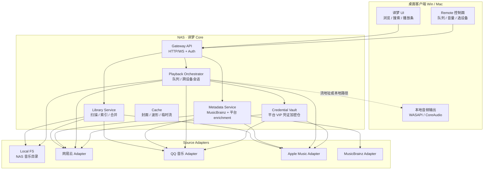
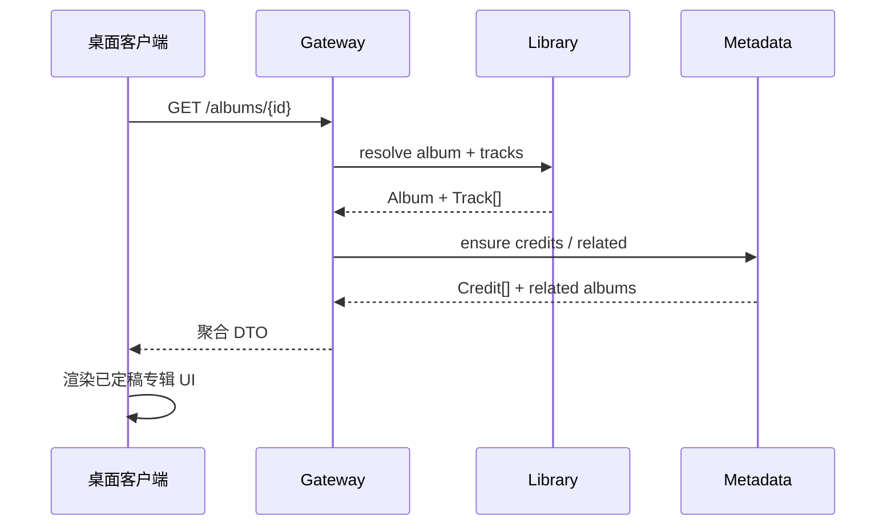
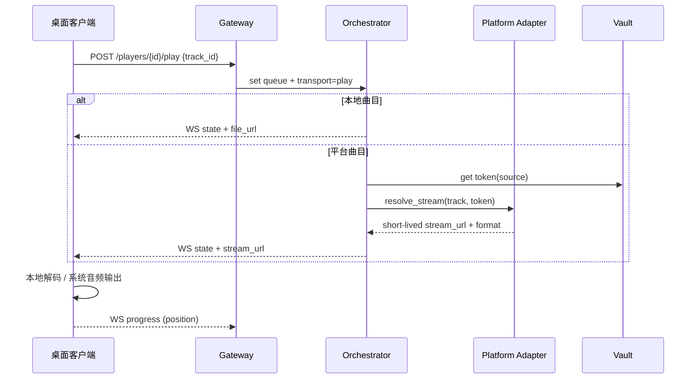

# 译梦 · 系统架构设计

> 个人非商用 · Core 自托管于 NAS · Windows / Mac 桌面客户端  
> 元数据：MusicBrainz + 网易云 / QQ 音乐 / Apple Music  
> 播放：本地曲库 + 各平台自有 VIP 账号合法取流

---

## 1. 目标与边界

| 要做 | 不做 |
|------|------|
| 统一浏览本地 + 多平台曲库 | 商用分发、多用户 SaaS |
| 高质量元数据合并与展示 | 破解 DRM / 盗刷他人账号 |
| Core 常驻 NAS，客户端轻量 | 把大索引和转码全塞进桌面端 |
| Win / Mac 原生体验桌面 App | 移动端首期（可后补 Remote） |

设计原则：

1. **Core 是唯一真相源**：曲库索引、播放队列、设备状态都在 Core。
2. **平台能力进适配器**：网易 / QQ / Apple 的登录、搜索、取流互不渗透。
3. **客户端只负责 UI 与本地设备**：渲染、快捷键、音频输出设备选择；业务逻辑尽量 RPC 到 Core。
4. **账号与密钥不出 Core**：平台 Token 只落在 NAS 加密存储，客户端不持有长期凭证。

---

## 2. 总览



---

## 3. 逻辑分层

```
┌─────────────────────────────────────────────────┐
│  Presentation   译梦桌面 UI（已定专辑/艺人视觉）   │
├─────────────────────────────────────────────────┤
│  Client Runtime 播放器壳 / 设备枚举 / 快捷键     │
├─────────────────────────────────────────────────┤
│  Core API        REST + WebSocket 会话            │
├─────────────────────────────────────────────────┤
│  Domain          Library · Metadata · Playback    │
├─────────────────────────────────────────────────┤
│  Adapters        Local · 网易 · QQ · Apple · MB   │
├─────────────────────────────────────────────────┤
│  Infra           SQLite/Postgres · 对象缓存 · Vault│
└─────────────────────────────────────────────────┘
```

- **Presentation**：严格按已定稿 UI（暗色、石灰绿、毛玻璃播放条）。
- **Client Runtime**：只处理「这台电脑怎么出声、怎么显示」。
- **Domain**：与平台无关的曲目 / 专辑 / 艺人 / 播放列表模型。
- **Adapters**：把各源映射成统一 Domain 模型；失败互不影响。

---

## 4. 核心子系统

### 4.1 Library Service（曲库）

职责：

- 扫描 NAS 本地目录（可配置多路径）。
- 周期性 / 手动同步各平台「我的收藏 / 已购 / 云盘」（视平台 API 能力）。
- 生成统一 `Track / Album / Artist / Release` 实体，带来源标签（`local` | `netease` | `qq` | `apple`）。

合并策略（简版）：

1. 优先 **MusicBrainz Recording / Release** 做锚点。
2. 平台 ID 作为辅键写入 `external_ids`。
3. 同名冲突用：时长 ±2s、ISRC、专辑名+艺人 联合打分。
4. 封面：本地嵌入 > 平台高清 > MusicBrainz Cover Art。

### 4.2 Metadata Service

- MusicBrainz：艺人关系、作品年表、Credits（作词/作曲/制作/混音）。
- 平台 enrichment：热度、歌词（若授权）、音质档位标签（Hi-Res 等）。
- 结果写入本地元数据库，客户端只读 Core，不直连 MB。

### 4.3 Playback Orchestrator

会话模型类似 Roon Zone：

| 概念 | 含义 |
|------|------|
| `Player` | 一台能出声的端（本机桌面 / 后续 DAC 设备） |
| `Queue` | 有序曲目列表 + 当前游标 |
| `Transport` | play / pause / seek / next + 音量 |

取流决策：

```
若 track.source == local     → Core 提供文件 URL / 直传路径
若 track.source == platform  → 对应 Adapter 用 Vault 凭证换「短时播放地址」
                              → 客户端用官方许可方式播放（或 Core 代理合法流）
从不在客户端持久化平台密钥；播放地址短 TTL，过期由 Orchestrator 续签。
```

### 4.4 Credential Vault

- 各平台 OAuth / 扫码登录在 **客户端浏览器或系统 WebView 完成**，Token 交 Core 加密落盘。
- 密钥：NAS 本机密钥环或用户口令派生；Core 进程内存持有，不写进客户端配置。
- 权限最小化：只申请播放与资料库读取，不申请社交写操作。

### 4.5 Gateway API

- `HTTP`：曲库查询、搜索、收藏、设置。
- `WebSocket`：播放状态、队列变更、扫描进度、多端同步。
- 鉴权：家庭局域网默认配对码；若暴露到公网必须 Token + TLS（可选 Tailscale / 反向代理）。

---

## 5. 统一领域模型（节选）

```text
Artist { id, name, aliases[], mb_id?, images[], source_ids{} }
Album  { id, title, artist_ids[], year, cover_url, mb_release_id?, source_ids{} }
Track  { id, title, album_id, artist_ids[], duration_ms,
         source, source_track_id, quality_tags[],
         credits[]?, lyrics_ref? }
Credit { role: lyricist|composer|producer|mix|studio, name, mb_id? }
Player { id, name, device_type, capabilities[] }
Queue  { player_id, items[], index, shuffle, repeat }
```

UI 专辑页的「曲目列表 / 制作名单 / 相关专辑」分别读 `Track[]`、`Credit[]`、关联 `Album[]`。

---

## 6. 关键路径

### 6.1 打开专辑页



### 6.2 点击播放



---

## 7. 客户端技术取向（建议）

| 项 | 建议 | 理由 |
|----|------|------|
| 壳 | **P0：Web 预览**；上架前再选 Tauri 2 或 Electron | 先验证 UI/API；安装包阶段再定壳 |
| UI | React / Vue + 已定视觉 Token | 与 Superdesign 稿对齐快 |
| 音频 | 系统解码优先；Hi-Res 再评估专有管道 | 首期稳，再追 bit-perfect |
| 与 Core 通信 | HTTP + WebSocket | 状态实时、实现简单 |
| 配对 | 首次输入 Core 地址 + 配对码 | 家庭 NAS 场景够用 |

首期不做移动 App；UI 稿可复用为后续 Remote。

---

## 8. Core 部署（NAS）

推荐形态：

- **单 Docker Compose**：`core` + `db`（SQLite 起步 / Postgres 可切换）+ `volumes`（音乐目录只读挂载、缓存、Vault）。
- 端口：仅局域网 `lan:8741`（示例）；公网走 VPN。
- 资源：索引期 CPU/磁盘高；稳态以元数据 DB + 轻量 API 为主。

目录约定示例：

```text
/music/...              # 用户曲库（只读挂载）
/var/yimeng/library.db    # 索引与元数据
/var/yimeng/cache/        # 封面与临时
/var/yimeng/vault/        # 加密凭证
```

---

## 9. 适配器契约

每个 Source Adapter 实现同一接口（示意）：

```text
search(query) -> Hit[]
get_artist / get_album / get_track
list_user_library()          # 需登录
resolve_stream(track_id)     # 需登录；返回短时 URL + codec
refresh_credentials()
```

MusicBrainz Adapter **没有** `resolve_stream`，只参与 metadata。

隔离规则：

- 某平台挂了，只灰掉该源标签，本地与其它源仍可用。
- 超时与限流在 Adapter 内消化，不拖垮 Gateway。

---

## 10. 安全（个人场景也要做）

1. Vault 加密；备份不含明文 Token。
2. 配对码 + 可选设备白名单。
3. 平台登录引导至官方页面，不收集密码到第三方。
4. 日志脱敏：禁止打印 Token、Cookie、完整流 URL 查询串。
5. 若以后做远程访问：强制 TLS + 强 Token，默认关闭公网。

---

## 11. 分期落地

| 阶段 | 交付 | 说明 |
|------|------|------|
| **P0** | Core 骨架 + 本地扫描 + 专辑/艺人 API + **Web 预览播本地文件** | 对齐已定 UI；桌面壳延后 |
| **P1** | MusicBrainz 元数据 + Credits 制作名单 | 专辑页 Credits 区块可用真数据 |
| **P2** | **Apple Music Adapter**（首家平台） | MusicKit / 官方授权登录 + Vault + 取流播放 |
| **P3** | 网易云 / QQ 音乐 Adapter + 跨源合并去重 | 统一艺人页作品年表 |
| **P4** | 多 Player / 队列同步 / 更精音频管道 | 接近 Roon Zone 体验 |

---

## 12. 与已定 UI 的映射

| 界面 | 主数据 | API（示意） |
|------|--------|-------------|
| 专辑页 | Album + Tracks + Credits + Related | `/albums/{id}` |
| 艺人页 | Artist + TopTracks + Discography + Related | `/artists/{id}` |
| 播放条 | 当前 Queue 项 + Transport | WS `/ws/player` |
| 来源胶囊 | `source_ids` / 账号状态 | `/sources` |

视觉 Token（石灰绿 `#C8F542`、表面 `#1A1A1F`、毛玻璃播放条）保持与 Superdesign 定稿一致，实现时抽成 Design Tokens，不在业务层写死散落色值。

---

## 13. 已拍板

- **P2 首家平台 Adapter：Apple Music**（网易云、QQ 音乐放 P3）。
- **Core 语言：Go**（单二进制部署 NAS；与客户端用 OpenAPI 对齐）。

## 14. 已拍板（续）

- **桌面壳**：暂不定 Tauri / Electron；**P0 用 Web 预览** 联调 UI 与 Core API，壳技术延后到要上桌面安装包时再选。

## 15. 仍待拍板

1. **NAS 环境**：是否已有 Docker？系统是群晖 / 威联通 / 自建 Linux？
2. **数据库**：P0 用 SQLite 是否可接受（单机 NAS 足够）？

### Apple Music Adapter 要点（P2 预留）

- 登录：MusicKit / Apple ID 官方授权（客户端 WebView 或系统流程），Token 只写入 Core Vault。
- 能力：目录浏览、搜索、资料库同步、按账号权益取流（勿绕过 DRM）。
- 元数据：与 MusicBrainz 合并时用 ISRC / UPC / 时长打分；封面优先平台高清。
- 风险：桌面端 MusicKit 能力因平台而异，P2 需先做 **Win/Mac 可行性探针** 再定取流是「客户端直播」还是「Core 协调 + 系统播放器」。

---

*文档版本：v0.4 · 2026-10-21 · Core=Go · P2=Apple Music · P0=Web 预览 · UI 定稿：专辑 a146b1b3 / 艺人 ff861594*
